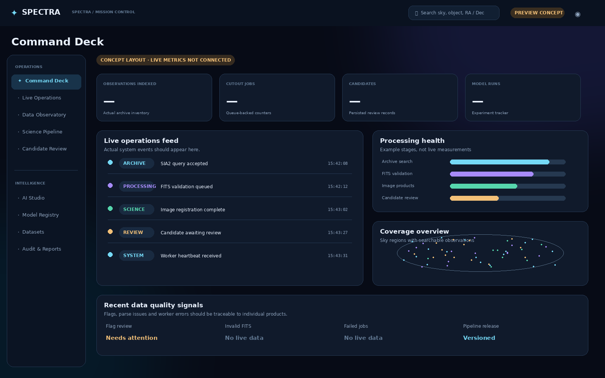
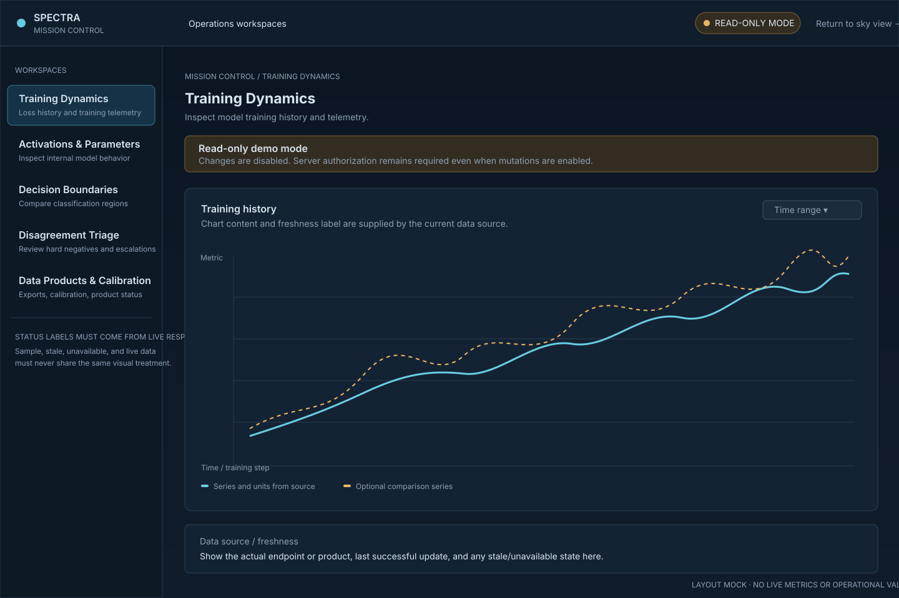

# 08 — Admin Mission Control Redesign

## Purpose and limits

Repair the first impression and navigation of `/admin/*` while retaining every current operational tool. This is a presentation and route-loading specification. It does not change scientific behavior, server permissions, database contracts, observer identity, or the public `/explore/*` experience.

The route shell currently exposes five workspaces in `web-client/src/admin/AdminLayout.tsx`: Dynamics, Internals, Boundaries, Triage, and Exports. `web-client/src/App.tsx` lazy-loads the admin shell inside a `Suspense` boundary whose fallback replaces the entire route tree. The captured admin screen shows that fallback. This proves the loading state was visible in the capture, but does not by itself establish whether the workspace was slow, the chunk failed, or the capture occurred before completion. Verify the runtime before calling this a fixed loading bug.

## Visual reference

The proposed shell arrangement is shown in this editable mock. It uses labeled placeholders instead of invented operational values:

Reference patterns:

- [shadcn dashboard blocks](https://ui.shadcn.com/blocks/dashboard): grouped workspace navigation, compact cards, tables, and chart panels. Compose with Spectra's existing components; do not copy their branding.
- [TanStack Table](https://tanstack.com/table/latest): reference for dense, responsive operational tables if the app already has an appropriate table primitive. Do not add a package for this redesign.
- [Grafana dashboards](https://grafana.com/docs/grafana/latest/dashboards/): reference for clear panel titles, time/context controls, and visible data freshness. Do not add Grafana or imply its operational model exists here.

## Information architecture and layout

### Shared shell

- Keep the `/admin/*` route physically separate from `/explore/*`; never add admin links to the public command header.
- Use a compact header with Spectra Mission Control identity, the current workspace title, a factual environment/service status only when backed by a real response, and a persistent `Read-only mode` notice when mutations are disabled.
- Replace the numbered horizontal tab strip with a left workspace rail on desktop. Each item has a stable name, short purpose, and active state. Preserve these direct paths and labels:

| Existing path | Workspace label | Capability to retain |
|---|---|---|
| `/admin/dynamics` | Training Dynamics | Loss/training history and training telemetry |
| `/admin/internals` | Activations & Parameters | Parameter updates and activation inspection |
| `/admin/boundaries` | Decision Boundaries | Boundary visualization and model comparison |
| `/admin/triage` | Disagreement Triage | Hard-negative review and escalation workflow |
| `/admin/exports` | Data Products & Calibration | Export management, calibration, and data products |

- Put the active workspace in a flexible main panel. Use a consistent page title, one sentence describing the task, controls beside the data they affect, and a large primary visualization/table before secondary details.
- Keep `Return to sky view` as a visible secondary action, linking to `/explore?tab=navigator`.
- Do not add a new overview dashboard with fabricated totals, health percentages, latest runs, or live activity. If a real aggregate endpoint is later available, specify its source and freshness before adding summary cards.
- Avoid the existing `Clearance: SEC` badge unless the server supplies an actual, meaningful clearance state. It currently reads as a security claim without visible provenance.

### Responsive behavior

- At desktop widths, show a persistent workspace rail and allow dense plots/tables to use the remaining width.
- At tablet/mobile widths, collapse the rail into a labeled workspace selector or drawer. Keep the read-only notice and active workspace name visible.
- Stack filters and controls above their data panel. Tables may scroll within their own container; the page itself must not acquire horizontal overflow.
- Give charts a minimum usable height and preserve axis labels/legends. Provide a table or textual summary when a chart cannot be read on a narrow screen.

## Route loading and failure behavior

1. Put a route-local loading shell around the lazy admin boundary so public routes do not display `Loading Spectra workbench...` while an admin chunk is loading.
2. Add a route-level error boundary for rejected dynamic imports. It must show a retry action and a link back to `/explore?tab=navigator`; never leave a permanent spinner or blank screen.
3. Keep the shell visible while workspace data loads. Each workspace must distinguish loading, no data, stale data, unavailable service, and request failure. Retain the last valid view only with a visible stale timestamp/source label.
4. Consider loading workspace modules separately only if bundle/network measurements show the current shared admin chunk is a material cause. The current screenshot alone is not proof of that cause.
5. Verify direct entry and in-app navigation for all five routes, including a cold load, a failed chunk/data request, and retry. Confirm the URL remains the source of the active workspace.

## Security and data honesty — non-negotiable

- Keep zero-auth access; do not add login screens, password modals, or JWT gates.
- Preserve `ADMIN_MUTATIONS_ENABLED=false` as the default and keep the read-only mode notice persistent while disabled.
- A disabled action must be visibly disabled with a concise reason. When enabled, mutation still requires server-held `ADMIN_TOKEN`; frontend state is not authorization.
- Keep verified moderator replies and their `[Moderator]` badge behavior unchanged.
- Never display invented live metrics, seeded operational activity, or concept screenshot values as real. Label sample/demo data explicitly. Show source, last update, and error/empty state near each operational display.
- Do not expose secrets, raw observer keys, or internal observer IDs in the admin UI.

## Implementation sequence

1. Reproduce and classify the captured loading symptom on a cold direct visit to `/admin/dynamics`; inspect console/network failures and wait for route settling.
2. Implement route-local pending/error states and verify route recovery before changing the workspace shell.
3. Recompose `AdminLayout` to the shared rail/header/content layout; keep all five paths and existing child workspaces intact.
4. Make each workspace responsive using its current chart/table as the primary content. Do not replace or silently omit a capability to fit the new shell.
5. Verify read-only presentation and server-backed status/data states with backend available and unavailable.

## Acceptance checklist

- [ ] Direct visits render each of the five workspace routes without a persistent global loading fallback.
- [ ] Failed lazy imports show a recoverable route-level error state.
- [ ] All five tools, controls, data views, and direct URLs remain available.
- [ ] Public and admin route separation remains intact; public navigation does not expose admin tools.
- [ ] Read-only mode is clear and persistent when mutations are disabled; no client-only control can bypass server authorization.
- [ ] Loading, empty, stale, unavailable, and failed data states are distinct and truthful.
- [ ] Desktop and mobile layouts have no page-level horizontal overflow; dense tables scroll locally.
- [ ] No illustrative concept metric is shown as a live value.
- [ ] Existing moderator verification and badge behavior remain unchanged.
