# Screenshot Gallery

The screenshots below are bundled for review on branch `Law-experimenral`. `current/` contains screenshots captured from the local app in headless Chrome. `concept/` contains original Spectra concept mockups copied from the user-provided concept kit. Concept images contain illustrative content and are not SPHEREx measurements.

## Current app — desktop

| Screen | Capture |
|---|---|
| Landing page, 1440 × 1000 | [home](current/spectra-home.png) |
| Navigator, 1440 × 1000 | [navigator](current/spectra-navigator.png) — black canvas at capture time while external loading was in progress; verify in a regular browser |
| Comparator, 1440 × 1000 | [comparator](current/spectra-comparator.png) |
| Spectrum, 1440 × 1000 | [spectrum](current/spectra-spectral.png) |
| Ice Studio, 1440 × 1000 | [ice](current/spectra-ice.png) |
| Discussions, 1440 × 1000 | [discussions](current/spectra-discussions.png) |
| Admin route, 1440 × 1000 | [admin loading state](current/spectra-admin.png) — lazy route still loading in this capture |

### Mobile comparator

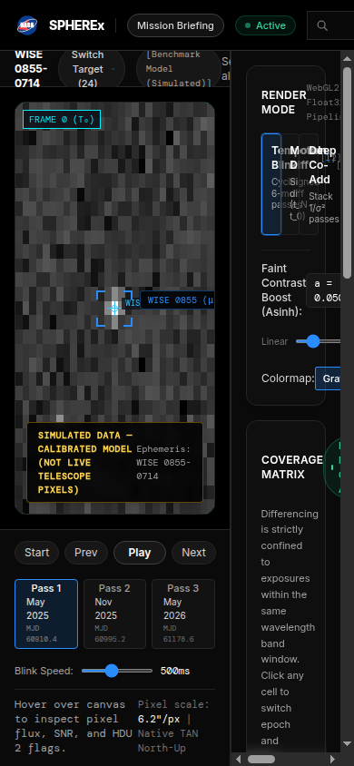

## Spectra concept mockups

### Public home

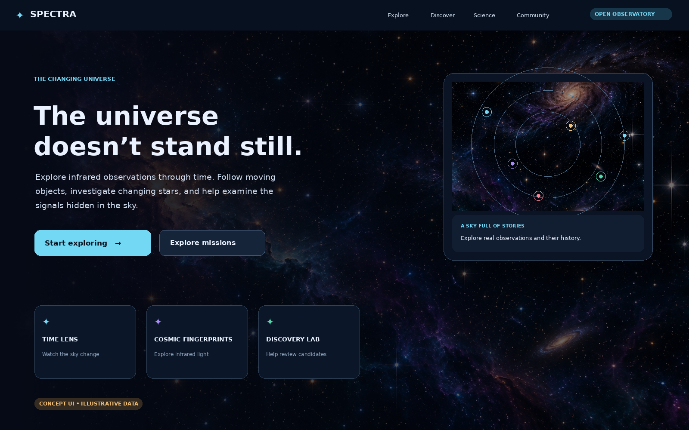

### Explorer

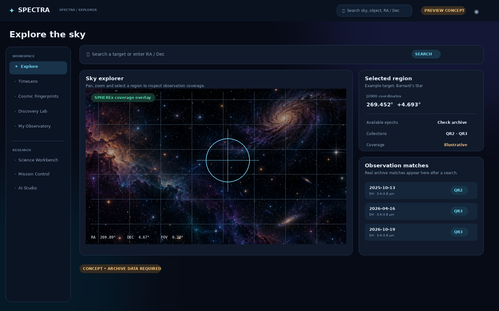

### TimeLens

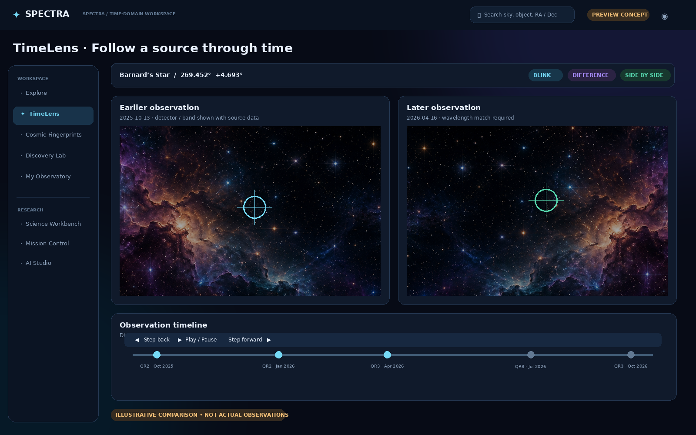

### Cosmic Fingerprints

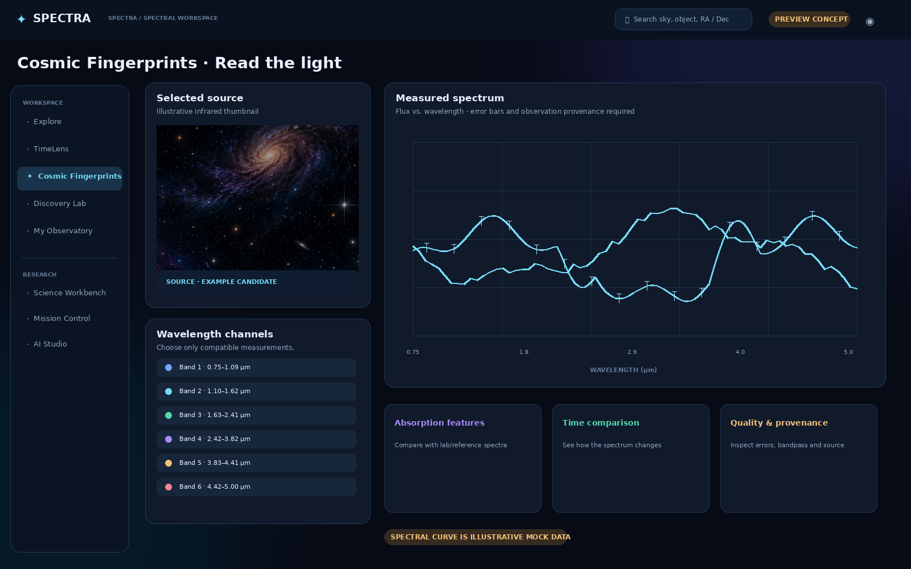

### Discovery Lab

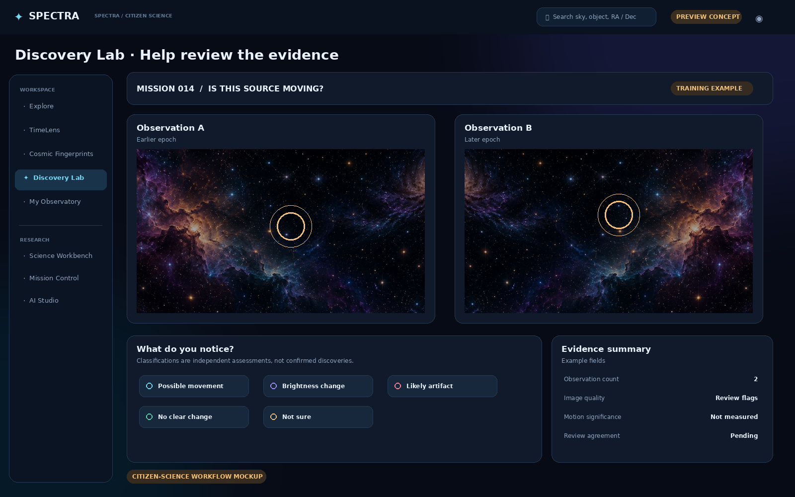

### Science Workbench

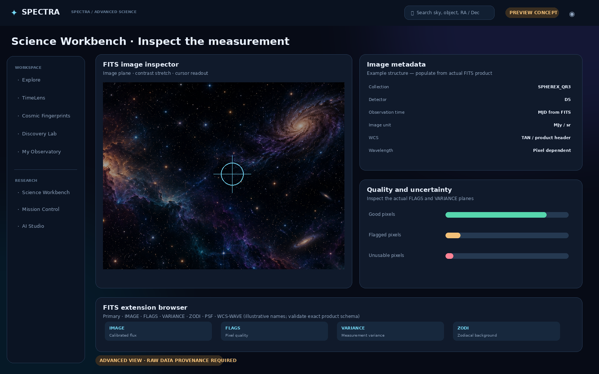

### Mission Control

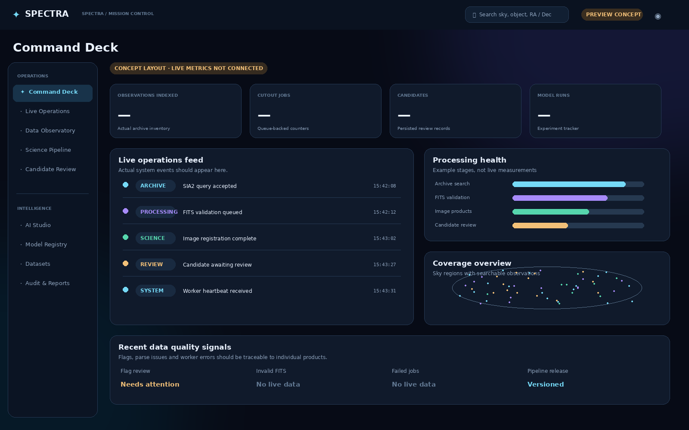

### Contact sheet

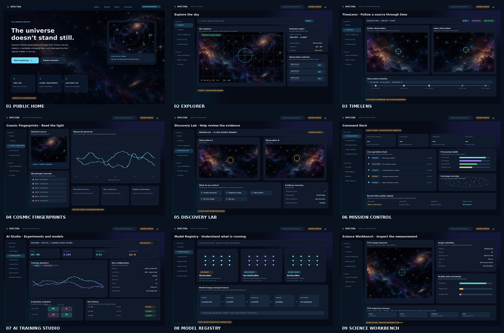

## Proposed Spectra layout mock

### Review Desk — desktop

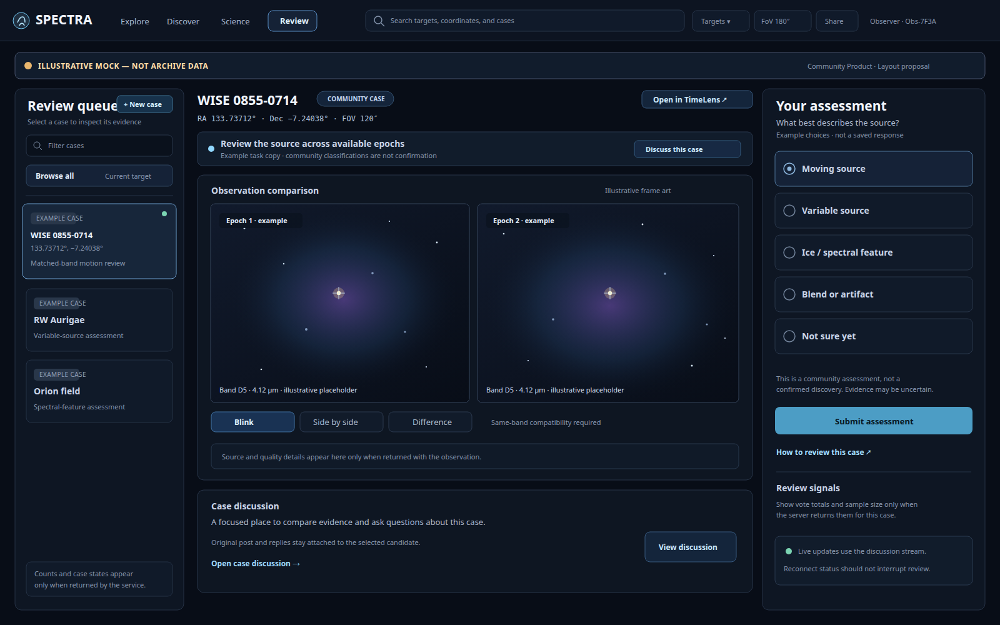

The [PNG screenshot](proposed/review-desk-desktop.png) and [editable SVG source](proposed/review-desk-desktop.svg) are original design artifacts, not archive imagery or third-party product captures. See the [full Review Desk specification](../06-community-review-desk.md) for mobile layout, behavior, API boundaries, accessibility, and empty/error states.

### Admin Mission Control — desktop shell

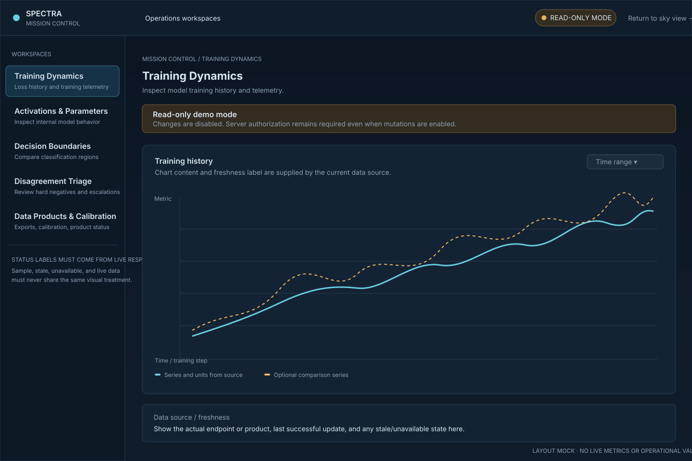

See the [Admin Mission Control specification](../08-admin-mission-control.md) for route loading recovery, workspace preservation, security constraints, and responsive acceptance criteria.

## External reference products

Third-party product screenshots are not redistributed here. Use the direct links and pattern mappings in [04-reference-patterns.md](../04-reference-patterns.md) to inspect NASA Eyes, Aladin Lite, IRSA, Zooniverse, GitHub Discussions, JS9, shadcn, and Linear.
